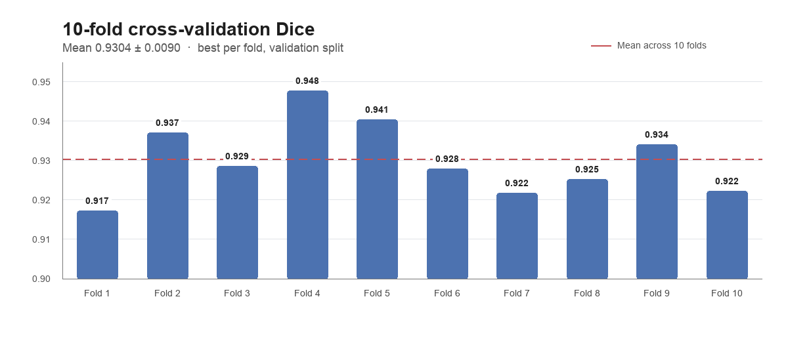

# Medical Image Segmentation with U-Net

Binary medical image segmentation with a U-Net + EfficientNet-B1 encoder,
10-fold cross-validation, and a 10-model ensemble.

## What this is

This repository trains a U-Net with an ImageNet-pretrained EfficientNet-B1
encoder for binary medical image segmentation. It uses a combined BCE + Lovasz
+ Dice loss, 10-fold cross-validation, early stopping, and an ensemble of the
10 fold models at inference time.

The goal is a reproducible baseline for medical image segmentation, not a
clinical product.

**Status:** research/portfolio project. Not validated for clinical use.

## Results

10-fold cross-validation, best validation Dice per fold:

| Fold | Best Dice |
|------|-----------|
| 1 | 0.9173 |
| 2 | 0.9372 |
| 3 | 0.9287 |
| 4 | 0.9479 |
| 5 | 0.9405 |
| 6 | 0.9280 |
| 7 | 0.9218 |
| 8 | 0.9254 |
| 9 | 0.9342 |
| 10 | 0.9224 |

**Mean Dice: 0.9304 ± 0.0090**



The mean is the average of the best validation Dice across the 10 folds. It is
not an independent test score.

## Dataset

Public Kaggle dataset:

https://www.kaggle.com/datasets/thnhtv1412/2425-ii-ait-3002-medical-image-segmentation

- Image/mask pairs for binary segmentation.
- Notebook path: `/kaggle/input/2425-ii-ait-3002-medical-image-segmentation/Dataset`
- Size: ~882 MB.
- License: not specified on the dataset page. Check before reuse.

## Method

| Component | Setting |
|---|---|
| Model | U-Net + EfficientNet-B1 encoder (ImageNet) |
| Decoder | SCSE attention, dropout 0.4 |
| Input size | 128 × 128 |
| Loss | 0.3 BCE + 0.4 Lovasz + 0.3 Dice |
| Optimizer | AdamW, lr 1e-4, weight decay 1e-4 |
| Schedule | CosineAnnealingLR, 60 epochs |
| Batch size | 16 |
| Validation | 10-fold KFold, early stopping (patience 10) |
| Inference | Mean of 10 fold models, threshold 0.5 |

Training augmentation: horizontal/vertical flips, shift-scale-rotate,
brightness/contrast, elastic/grid distortion, resize, and normalization.

Validation/test preprocessing: resize to 128 × 128 and normalize.

## Quick start (Kaggle)

1. Open `main.ipynb` in Kaggle.
2. Attach the dataset above to the notebook.
3. Enable a GPU accelerator.
4. Check that `CONFIG.BASE_INPUT_DIR` points to the dataset `Dataset` folder.
5. Run all cells.

The notebook trains 10 folds, reports per-fold Dice, and creates an ensemble
submission for the test set.

Expected result: mean validation Dice around **0.930**.

## Local setup

The notebook was run on Kaggle with Python 3.11. A local CUDA GPU is recommended.

```bash
git clone https://github.com/plnatoic/Medical-Image-Segmentation.git
cd Medical-Image-Segmentation

pip install torch torchvision segmentation-models-pytorch albumentations \
  opencv-python scikit-learn pandas numpy matplotlib
```

The repository does not include a `requirements.txt`; versions are not pinned.
Set `CONFIG.BASE_INPUT_DIR` to your local `Dataset` directory, then run
`main.ipynb`.

## Project structure

```text
.
├── main.ipynb    # preprocessing, training, evaluation, ensemble inference
└── README.md
```

## Limitations

- Single dataset; no external validation set.
- Input is resized to 128 × 128, which can remove small structures.
- Binary masks only; no multi-class segmentation.
- Reported Dice is 10-fold cross-validation, not an independent test score.
- No inference script or model checkpoint is included.
- Dataset license is unknown.

## When not to use this

- Do not use it for clinical diagnosis or treatment decisions.
- Do not expect reliable results on images from a different domain without
  retraining or validation.
- Do not use it for high-resolution segmentation where 128 × 128 inputs would
  erase the structures of interest.

## License

No license is specified. Add a license before redistributing or reusing the
code.

## Acknowledgements

- Dataset: [`thnhtv1412`](https://www.kaggle.com/datasets/thnhtv1412/2425-ii-ait-3002-medical-image-segmentation) on Kaggle.
- Segmentation models: [`segmentation_models_pytorch`](https://github.com/qubvel-org/segmentation_models.pytorch).

## Questions

Open an issue on GitHub:
https://github.com/plnatoic/Medical-Image-Segmentation/issues
